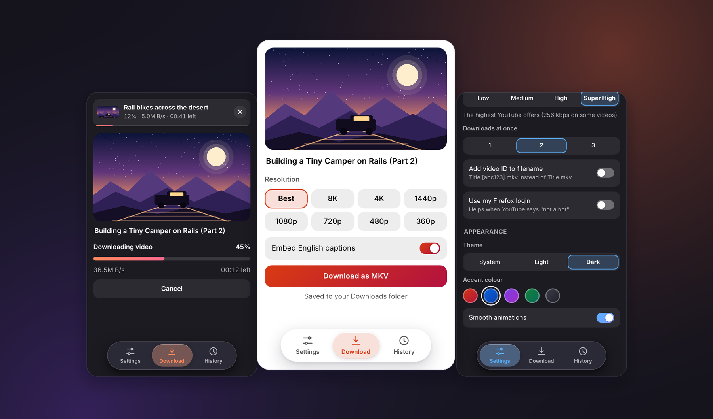
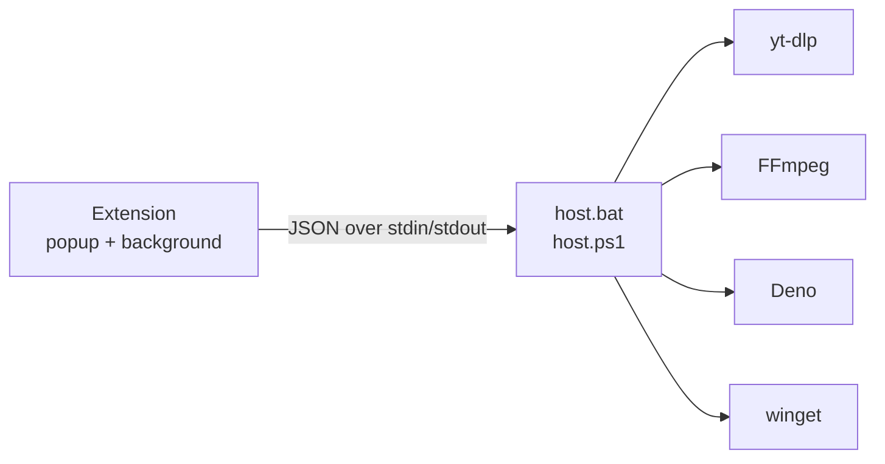

<div align="center">


# Aurora Downloader

**Download videos and audio from your browser with yt-dlp. One click, no copy-pasting links.**

[](https://github.com/Realtechno9952/Aurora-Downloader/releases)


[Features](#features) · [Install](#install) · [How it works](#how-it-works) · [Privacy](#what-the-helper-can-and-cant-do) · [Troubleshooting](#troubleshooting) · [Development](#development)

<br>



</div>

<br>

Aurora Downloader is a browser extension plus a small PowerShell helper. The extension gives you a clean popup with a floating glass dock. The helper runs [yt-dlp](https://github.com/yt-dlp/yt-dlp) and [FFmpeg](https://ffmpeg.org) on your computer, so downloads happen locally, with your own tools, at full quality.

It works in **Firefox** and in **Chromium browsers** (Chrome, Edge, Brave, Helium). It is currently in beta.

> This project started life as *yt-dlp Launcher*, so the GitHub page and the files inside the download still use that name.

## Features

**Downloading**
- Any site yt-dlp supports. YouTube (videos, Shorts, live, music, playlists) plus Vimeo, Twitch, X, Reddit, TikTok, Instagram, Facebook, Dailymotion, SoundCloud, Bandcamp and more.
- Resolution from Best (up to 8K) down to 360p, and four audio quality tiers.
- Output as **MKV**, **MP4** (H.264/AAC for editors), **WebM**, or audio only: **MP3**, **M4A**, **Opus**, **FLAC**.
- **Clip tool:** download just a section, with optional frame-accurate cuts.
- **Playlists** with a limit, numbered filenames, and one-click "this video only".
- Queue with up to three downloads at once, a progress card for each, and cancel at any time.

**Inside the file**
- Subtitles (choose languages), chapters, metadata, thumbnail and description.
- SponsorBlock, and an optional info JSON (MKV only).
- Save a video's thumbnail as PNG, JPG, WebP and more.

**Quality of life**
- History of your last 50 downloads, with **Open file**, **Show in folder** and **Download again**.
- `Alt+Shift+D` downloads the current page with your default settings.
- Light, dark or system theme, five accent colours (Ember, Ocean, Violet, Forest, Graphite), animations you can turn off.
- Update checker for yt-dlp, FFmpeg and the extension itself. It only offers versions that are really newer than what is installed.
- A warning with a one-click install if Deno is missing (YouTube needs a JavaScript runtime).

## Install

This takes about five minutes, and you only do it once.

**Before you start:** you need Windows 10 or 11, and one of these browsers: Firefox, Chrome, Edge, Brave or Helium.

### Step 1: Install the three free tools

Aurora Downloader uses these programs to do the actual downloading.

1. Press the **Windows key**, type **PowerShell**, and press **Enter**.
2. Copy and paste these three lines, then press **Enter**:

   ```powershell
   winget install yt-dlp.yt-dlp
   winget install yt-dlp.FFmpeg
   winget install DenoLand.Deno
   ```

   If it asks you to agree to something, type `Y` and press **Enter**.

### Step 2: Download Aurora Downloader

1. Go to the [Releases page](https://github.com/Realtechno9952/Aurora-Downloader/releases) and download the newest **zip file** listed under **Assets**.
2. Right-click the zip, choose **Extract All**, and pick a folder you will keep, for example `C:\Tools\aurora-downloader`.

   Don't use Downloads or the Desktop. If you move the folder later, just do Step 3 again.

### Step 3: Run the installer

Open the **host** folder and **double-click `install.bat`**. A window opens and sets everything up. Wait until it says **All set**.

- If Windows shows a blue "Windows protected your PC" box, click **More info**, then **Run anyway**.
- If you see red lines, read them. They say what is missing, and it is usually a tool from Step 1.

### Step 4: Add the extension to your browser

**Firefox**

1. Type `about:debugging#/runtime/this-firefox` in the address bar and press **Enter**.
2. Click **Load Temporary Add-on...**
3. Open the **`extension`** folder and choose the file called **`manifest.json`**.

**Chrome, Edge, Brave or Helium**

1. Type `chrome://extensions` in the address bar and press **Enter**. (Edge: `edge://extensions`. Brave: `brave://extensions`. Helium: use its extensions page, which looks the same.)
2. Turn on **Developer mode** (the switch at the top right).
3. Click **Load unpacked**.
4. Choose the folder called **`extension-chromium`**. It is not the one called `extension`.

### Step 5: Download something

1. Open a video page.
2. Click the orange download-arrow icon in your toolbar. If you can't see it, open the puzzle-piece menu and pin it.
3. Pick a quality and press **Download**.

Your file goes to your Downloads folder. You can change that in **Settings**. When a download finishes, press **Open file** to play it.

### Good to know

- **Firefox forgets temporary add-ons** when it closes, so repeat the Firefox part of Step 4 after a restart. A permanent version is planned.
- **After updating,** run `install.bat` again.
- **To remove it,** open the **host** folder, double-click `uninstall.bat`, then remove the extension on your browser's extensions page.
- **Stuck?** See [Troubleshooting](#troubleshooting).

## How it works

Browser extensions cannot run programs, so the extension talks to a small helper through the browser's [Native Messaging](https://developer.mozilla.org/docs/Mozilla/Add-ons/WebExtensions/Native_messaging) feature. The browser starts the helper only when needed, and it exits when the job is done. There is no background service.



- The popup shows the page's video and sends your choices to the background script.
- The background script keeps the queue, history and settings, and talks to the helper.
- The helper finds the tools (its own `host/bin`, `PATH`, then WinGet's folders), builds the yt-dlp command, streams progress back, and cancels cleanly.

## What the helper can and can't do

**It can:**
- run yt-dlp and FFmpeg for the video you chose
- save files to your download folder, open a finished video, and show it in Explorer
- check for updates and install them with winget (yt-dlp, FFmpeg, Deno)

**It can't:**
- do anything the extension doesn't ask for. It only understands a short list of commands (download, thumbnail, versions, update, open, show in folder, pick or check a folder), and "open" only works on video and audio files
- be used by other websites or extensions. Only this extension is registered to talk to it, for your Windows user only

**Your login (cookies)**
- In **Firefox**, yt-dlp reads Firefox's cookies directly.
- In **Chrome, Edge, Brave and Helium**, those cookies are locked away from yt-dlp. If you switch on **Use my browser login**, the browser asks for permission. Then the extension reads the cookies for the site you are downloading from and gives them to the helper in a temporary file, which is deleted when the download ends. Nothing is uploaded anywhere.
- You can turn the login off at any time in Settings and remove the permission on your browser's extensions page.

## Troubleshooting

| Problem | Try this |
|---|---|
| "The helper isn't installed" | Run `install.bat`, then reload the extension. |
| Nothing happens in Chrome-based browsers | Load the `extension-chromium` folder, not `extension`. Run `install.bat` again after updating. |
| YouTube says "Sign in to confirm you're not a bot" | Install Deno (the popup offers a button), turn on **Use my browser login**, and make sure you are signed in to YouTube in that browser. |
| Login does nothing in Chrome, Edge or Brave | Allow the cookie permission when asked. YouTube sometimes invalidates cookies taken from an open tab, so sign in again and retry. Firefox is the most reliable. |
| "ffmpeg wasn't found" | `winget install yt-dlp.FFmpeg`, then restart your browser. |
| An update fails | The helper falls back to yt-dlp's own updater and shows winget's real error. You can also run `winget upgrade yt-dlp.yt-dlp` yourself. |
| Extension gone after restarting Firefox | Normal for temporary add-ons. Load it again. |
| I moved the folder | Run `install.bat` again. |

## Development

There is no build step. The extension is plain JavaScript and the helper is plain PowerShell.

```
aurora-downloader/
  extension/                    the extension (Firefox loads this folder)
    manifest.json               Firefox manifest (background.scripts)
    manifest.chromium.json      Chromium manifest (service worker + fixed key)
    background.js               queue, settings, history, updates
    popup/                      the popup UI and the glass dock
    lib/                        URL parser and browser compatibility helpers
  host/                         the native helper
    host.ps1, host.bat          the helper itself
    install.ps1, install.bat    registers the helper and makes the Chromium copy
    uninstall.ps1, uninstall.bat
  assets/                       logos and images
  preview.png                   screenshot used in this README
```

**Why two manifests?** Chromium rejects `background.scripts` in Manifest V3 and Firefox has no service workers, so each browser gets its own. `install.bat` makes `extension-chromium/` from `extension/` with the Chromium manifest swapped in. That copy is generated, so it is not in Git.

**Fixed extension ID.** The `key` in `manifest.chromium.json` gives Chromium browsers the same extension ID on every computer, which is what lets the helper allow only this extension. The same ID is in `host/install.ps1`.

**Versions.** Manifests only allow plain numbers, so a beta is written as a fourth number. Betas 2 to 4 used the beta number itself (`2.0.0.4` is beta 4); from beta 4.5 on it is ten times the beta, so `2.0.0.45` is beta 4.5 and `2.0.0.50` is beta 5. The helper's version in `host.ps1` must match the manifests.

## Roadmap

- Signed Firefox build and store listings, so no more temporary add-ons
- A paste-a-link box and saved download presets
- Channel monitoring for keeping an archive up to date
- Automated tests on a Windows runner

Ideas and bug reports are welcome in [Issues](https://github.com/Realtechno9952/Aurora-Downloader/issues).

## Responsible use

Only download content you own or have permission to save, and follow the terms of the sites you use. This project is not affiliated with yt-dlp, FFmpeg, Deno, YouTube, Mozilla or Google.

## Credits

Built on [yt-dlp](https://github.com/yt-dlp/yt-dlp), [FFmpeg](https://ffmpeg.org) and [Deno](https://deno.com).
